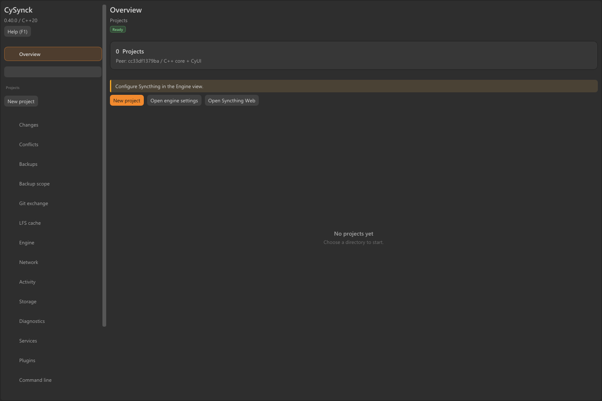

<table width="100%">
  <tr>
    <td width="300" align="left" valign="top">
      <a href="#manuel-hors-ligne">Aide hors ligne</a><br>
      <a href="https://github.com/MrMybal/CySynck">Dépôt</a><br>
      <a href="https://github.com/MrMybal/CySynck/issues">Problèmes</a><br><br>
      <sub>README</sub><br>
      <a href="README.md">English</a> · <a href="README.fr.md">Français</a>
    </td>
    <td width="400" align="center" valign="middle">
      <strong>CySynck</strong><br>
      <sub>Application · CLI · SDK</sub>
    </td>
    <td width="300" align="right" valign="top">
      <p><sub>Licence de l’application</sub><br><a href="LICENSE"><strong>MIT</strong></a></p>
      <p><sub>Versions des sources</sub><br><a href="VERSION.fr.md"><strong>Application 0.40.0</strong><br>Pont Unreal 0.2.0</a><br><strong>EN DÉVELOPPEMENT</strong></p>
    </td>
  </tr>
</table>

<h1 align="center">CySynck</h1>

Synchronisez vos projets, conservez des sauvegardes versionnées et examinez les différences de fichiers depuis une seule application. CySynck est un compagnon de [Syncthing](https://github.com/syncthing/syncthing) en **C++20**, avec une application native [CyUI](https://github.com/MrMybal/CyUI), un CLI, une console Web et un SDK d’intégration commun. Il s’adresse aux personnes qui gèrent des dossiers partagés, des projets Git et des serveurs Linux.

> **EN DÉVELOPPEMENT · 0.40.0**
>
> Il s’agit de la version actuelle des sources ; aucune version binaire téléchargeable n’est encore publiée. Les versions de développement nécessitent une validation de votre usage cible. Consulter les [notes de version et limites documentées](VERSION.fr.md).

[](assets/screenshots/desktop-0.40.0.png)

## À propos de CySynck

Créez un projet pour chaque dossier et choisissez son mode de synchronisation, sa politique de sauvegarde ou sa procédure d’échange Git. L’application regroupe les différences, copies de récupération, instantanés, opérations Git/LFS et outils réseau. Son panneau de commandes utilise les mêmes commandes que le CLI autonome. L’interface Web d’origine de Syncthing reste accessible depuis la vue Moteur.

L’application native, le CLI et la console Web/API partagent un même cœur. Celui-ci peut aussi être intégré par son interface C++ ou son ABI C versionnée, avec des extensions natives de confiance pour ajouter des modes de projet. Les serveurs Linux peuvent être compilés sans dépendance graphique. L’anglais est la langue d’interface par défaut ; le français est également inclus.

## Fonctionnalités

- **Modes de projet** : synchronisation bidirectionnelle, envoi seul ou réception seule, sauvegardes, échanges Git explicites et modes d’extensions natives.
- **Sauvegardes** : planification, aperçu des exclusions, rétention, stockage par fichiers entiers/blocs fixes/blocs à découpage selon le contenu, vérification d’intégrité et restauration sélective.
- **Revue de fichiers** : différences bornées côte à côte ou unifiées, patches compatibles Git et résolution explicite des conflits avec conservation de copies de récupération.
- **Git et LFS** : échanges de bundles vérifiés, revue de branches/commits/trois versions, intégrations après revue, extraction séparée, gestion du cache, matérialisation, restauration des pointeurs et export des assets préservés.
- **Réseau direct** : appairage WireGuard, découverte d’adresses signées, candidates LAN/IPv6 directes, révocation par projet, tchat et transferts de fichiers vérifiés avec reprise par un canal authentifié à l’intérieur du VPN.
- **Application et exploitation** : icône de notification, démarrage à la connexion par profil, diagnostics et export de services systemd/LaunchAgent après revue.
- **Intégration** : cœur C++20, ABI C v1 utilisant du JSON UTF-8, options d’extensions typées et exemples C/C++/extensions compilables. Le [pont Unreal](integrations/unreal/README.fr.md) fournit les requêtes Blueprint asynchrones en file et la préparation du SDK.

## Manuel hors ligne

Le manuel **CyDoc** complet contient 45 sujets par langue, dont les tutoriels et références publiques C++/C/extensions. Recherche, favoris, notes et positions de lecture fonctionnent localement. La lecture ne nécessite ni serveur, ni CDN, ni Node.js, ni connexion Internet.

Après compilation des sources ou extraction d’un paquet complet de l’application, ouvrez la route du lecteur correspondant dans un navigateur :

| Langue | Chemin du lecteur depuis la racine du paquet ou du dépôt |
| --- | --- |
| English (par défaut) | `Documentation/Documentation.html#/en/overview` |
| Français | `Documentation/Documentation.html#/fr/overview` |

Conservez le dossier `Documentation/` entier, avec `DocData/`. Le lecteur généré n’est pas suivi dans Git et aucun manuel CySynck hébergé n’est actuellement publié ; les chemins ci-dessus deviennent disponibles après génération. Ouvrez-le en `file://`, ou utilisez l’aide contextuelle :

- **Application native** : **Aide (F1)** ouvre le sujet de la vue courante.
- **CLI** : `cysynck docs`, ou `cysynck docs git-materialization --language fr --print` pour obtenir l’URL locale sans lancer de navigateur.
- **Console Web** : l’aide contextuelle propose l’ouverture locale depuis un serveur en boucle locale ou l’archive complète `CySynck-Documentation.zip` pour un autre poste. Extrayez l’archive avant d’ouvrir son `Documentation.html`.

Pour générer seulement le manuel, lancez `npm ci --prefix .CyDocBuild`, puis `npm run build --prefix .CyDocBuild`. Le [guide de la chaîne documentaire](.CyDocBuild/README.md) décrit la rédaction et le suivi des traductions.

---

## Installation

Il n’existe actuellement **aucun téléchargement binaire publié**. Compilez les sources selon les étapes ci-dessous. La [page des versions](https://github.com/MrMybal/CySynck/releases) accueillera les futures distributions de l’application.

| Cible | Disponibilité | Lancement après installation dans `dist/` |
| --- | --- | --- |
| Windows x64 | Compilation depuis les sources ; application, CLI et paquet validés localement | `dist/bin/cysynck-desktop.exe` |
| Linux avec interface | Contrôles natifs CI de compilation/paquet/exécution réussis ; matériel et services à vérifier | `dist/bin/cysynck-desktop` |
| Serveur Linux | CI native et tests de vrais pairs Syncthing réussis ; services/tunnels sur l’hôte à vérifier | `dist/bin/cysynck serve` |
| macOS | CI native cœur/SDK/paquets validée, dont les captures desktop en rendu logiciel | `open dist/CySynck.app` |

Installez **Syncthing**, **Git**, **WireGuard** et **OpenSSL** séparément pour les fonctions qui en ont besoin ; OpenSSL fournit les signatures P-256 de CyRevision et des publications d’adresses VPN, et les outils de suivi Git LFS sont également externes. CySynck ne fournit pas ces programmes. WireGuard exige les privilèges adaptés et des points de terminaison UDP joignables ; la découverte des pairs ne suffit pas à traverser tous les NAT.

Pour un paquet Windows compilé localement, extrayez l’archive complète et lancez `Install-CySynck.ps1` depuis sa racine pour installer l’application pour l’utilisateur courant. L’usage portable est également possible. Gardez tous les dossiers du paquet ensemble, y compris les bibliothèques, ressources Web et le manuel. La page d’installation du manuel explique les mises à jour et la désinstallation.

Pour une première sauvegarde locale, utilisez le CLI dans `dist/bin/` avec un dossier existant :

```sh
cysynck project add Notes /chemin/absolu/notes --id notes --mode backup --interval 60 --keep 30
cysynck backup notes
cysynck verify notes
cysynck docs quickstart --language fr
```

Mettez les chemins contenant des espaces entre guillemets et examinez le champ `ok` du rapport de vérification. `--state DIR` sélectionne un profil privé. Les tâches planifiées nécessitent une application native ou un processus `cysynck serve` actif. Gardez des sauvegardes indépendantes et restaurez dans un nouveau dossier séparé ; les opérations multi-fichiers ne sont pas des transactions du système de fichiers.

## Sources, compilation et bibliothèques nécessaires

Prérequis : **CMake 3.24+**, **compilateur C++20**, Git, **Node.js 22+** et npm. Node.js sert à compiler le manuel ; il n’est pas nécessaire pour lancer l’application ou lire l’export. CMake récupère les dépendances natives épinglées. Une archive CyDoc épinglée est incluse dans le dépôt.

Windows utilise les outils C++ de Visual Studio 2022. macOS nécessite les Xcode Command Line Tools. Le desktop Linux exige OpenGL et les bibliothèques de développement X11/Wayland de GLFW ; `libayatana-appindicator3-dev` active l’icône de notification facultative. Le [workflow de compilation native](.github/workflows/build.yml) liste les paquets Linux utilisés en CI.

<details>
<summary>Récupérer les sources, compiler, tester et empaqueter</summary>

```sh
git clone https://github.com/MrMybal/CySynck.git
cd CySynck
npm ci --prefix .CyDocBuild
cmake -S . -B build -DCMAKE_BUILD_TYPE=Release
cmake --build build --config Release --parallel 3
ctest --test-dir build -C Release --output-on-failure
npm test --prefix .CyDocBuild
cmake --install build --config Release --prefix dist
cpack --config build/CPackConfig.cmake -C Release -B dist/packages
```

Ajoutez `-DCYSYNCK_DESKTOP=OFF` à la configuration pour un serveur sans interface. Autrement, `scripts/build.ps1` (`-ServerOnly` pour un serveur) et `scripts/build.sh` (`CYSYNCK_DESKTOP=OFF` pour un serveur) préparent les dépendances, compilent, testent et installent.

CMake génère et copie le manuel complet et `CySynck-Documentation.zip` dans le paquet de l’application. Les sources de rédaction documentaire ne sont pas distribuées. Pour régénérer le manuel séparément :

```sh
npm run build --prefix .CyDocBuild
npm test --prefix .CyDocBuild
```

Pour tester deux vrais pairs, configurez `-DCYSYNCK_TEST_SYNCTHING=/path/to/syncthing` avant compilation et CTest. Les pages d’intégration et d’extensions du manuel hors ligne décrivent le SDK installé et ses exemples.

Le [test optionnel multi-Gio](.CyDocBuild/internal/LARGE-WORKLOAD.md) vérifie l’interruption/reprise et la restauration CDC sur de vraies données lues par flux. Activez-le avec `-DCYSYNCK_LARGE_WORKLOAD_TESTS=ON` et prévoyez 18 Gio libres ; il est exclu des tests par défaut. La CI serveur Linux exécute aussi de vrais tunnels WireGuard dans des espaces réseau isolés.

</details>

---

## Licence

**CySynck utilise la [licence MIT](LICENSE).** Copyright © 2026 CyberAlien. Les composants tiers conservent leurs propres conditions.

### Bibliothèques tierces

| Bibliothèque · sources | Licence · texte | Utilisation / périmètre |
| --- | --- | --- |
| [nlohmann/json 3.12.0](https://github.com/nlohmann/json) | [MIT](https://github.com/nlohmann/json/blob/v3.12.0/LICENSE.MIT) | JSON du cœur et du SDK C++ public. |
| [cpp-httplib](https://github.com/yhirose/cpp-httplib) | [MIT](https://github.com/yhirose/cpp-httplib/blob/5814e121dfb5049f72a5c3956c3c8961b40da78b/LICENSE) | HTTP/API du cœur et réseau direct. |
| [PicoSHA2](https://github.com/okdshin/PicoSHA2) | [MIT](https://github.com/okdshin/PicoSHA2/blob/161cb3fc4170fa7a3eca9e582cebd27cc4d1fe29/LICENSE) | Vérifications SHA-256 du cœur. |
| [TinyXML2 10.0.0](https://github.com/leethomason/tinyxml2) | [zlib](https://github.com/leethomason/tinyxml2/blob/321ea883b7190d4e85cae5512a12e5eaa8f8731f/LICENSE.txt) | Configuration XML de Syncthing dans le cœur. |
| [CyUI](https://github.com/MrMybal/CyUI) | [MIT](https://github.com/MrMybal/CyUI/blob/a228501d9418550ce68d2d67b70cebbb8fa3ee2a/LICENSE) | Application native ; modules Diff et Inspector, incluant Code. |
| [Dear ImGui](https://github.com/ocornut/imgui) | [MIT](https://github.com/ocornut/imgui/blob/1ab953d75a760d5102eb2d5c4c6c4e65df6b29f3/LICENSE.txt) | Widgets et couches d’intégration de l’application native. |
| [GLFW 3.4](https://github.com/glfw/glfw) | [zlib/libpng](https://github.com/glfw/glfw/blob/3.4/LICENSE.md) | Fenêtre et contexte OpenGL de l’application native. |
| [Lexilla / Scintilla](https://github.com/MrMybal/CyUI/tree/a228501d9418550ce68d2d67b70cebbb8fa3ee2a/third_party) | [Conditions permissives Lexilla/Scintilla](https://github.com/MrMybal/CyUI/blob/a228501d9418550ce68d2d67b70cebbb8fa3ee2a/third_party/lexilla/License.txt) | Analyseurs lexicaux et interfaces utilisés par CyUI Code dans l’application native. |
| [CyDoc 0.1.0](https://github.com/MrMybal/CyDoc) | [MIT](https://github.com/MrMybal/CyDoc/blob/main/LICENSE) | Lecteur hors ligne distribué et compilateur documentaire ; archive épinglée et provenance dans [.CyDocBuild/vendor](.CyDocBuild/vendor). |
| [marked 17.0.6](https://github.com/markedjs/marked) | [MIT ; conditions Markdown incluses](https://github.com/markedjs/marked/blob/v17.0.6/LICENSE.md) | Compilation Markdown par CyDoc pendant la construction. |
| [PrismJS 1.30.0](https://github.com/PrismJS/prism) | [MIT](https://github.com/PrismJS/prism/blob/v1.30.0/LICENSE) | Coloration syntaxique à la compilation ; sa notice accompagne le manuel. |
| [esbuild 0.25.12](https://github.com/evanw/esbuild) | [MIT](https://github.com/evanw/esbuild/blob/v0.25.12/LICENSE.md) | Assemblage du lecteur pendant la construction. |
| [Happy DOM 21.0.4](https://github.com/capricorn86/happy-dom) | [MIT](https://github.com/capricorn86/happy-dom/blob/v21.0.4/LICENSE) | Tests documentaires uniquement. |
| [GTK3](https://gitlab.gnome.org/GNOME/gtk) / [Ayatana AppIndicator](https://github.com/AyatanaIndicators/libayatana-appindicator) | [Notices LGPL-2.1-ou-ultérieure / LGPL-2.1 ou LGPL-3.0](THIRD_PARTY.md) | Bibliothèques système facultatives pour l’icône Linux ; absentes des compilations sans interface. |
| Environnement d’exécution Microsoft Visual C++ | [Conditions de redistribution Microsoft](THIRD_PARTY.md) | Fichiers d’exécution redistribués avec les paquets Windows compilés par MSVC. |

Ce tableau indexe les principaux composants. Conservez les [notices tierces complètes](THIRD_PARTY.md) et textes des licences distribués dans `share/cysynck/licenses/`, les ressources macOS et `Documentation/DocData/licenses/`. Il ne remplace pas les notices des dépendances transitives. Aucun module média facultatif de CyDoc ni Three.js n’est inclus. Syncthing, Git et WireGuard restent des installations externes séparées avec leurs propres licences.

## Références et liens

- [Manuel hors ligne et aide contextuelle](#manuel-hors-ligne) · [Notes de version et limites](VERSION.fr.md).
- [Dépôt des sources](https://github.com/MrMybal/CySynck) · [Suivi des problèmes](https://github.com/MrMybal/CySynck/issues) · [Versions](https://github.com/MrMybal/CySynck/releases).
- [Génération documentaire et traductions](.CyDocBuild/README.md) · [En-têtes publics du SDK](include/cysynck) · [Exemples d’intégration](examples).
- [Syncthing](https://github.com/syncthing/syncthing) · [CyUI](https://github.com/MrMybal/CyUI) · [CyDoc](https://github.com/MrMybal/CyDoc) · [WireGuard](https://www.wireguard.com/).
- [SyncTrayzor](https://github.com/GermanCoding/SyncTrayzor) est une référence fonctionnelle. Le transport Git/LFS signé de [CyRevision](https://github.com/MrMybal/CyRevision) 0.1.34 dispose d’un adaptateur C++ avec identités explicitement approuvées et tests réels dans les deux sens. Les admissions de groupe restent gérées par CyRevision. Leurs implémentations ne sont pas incorporées dans l’application ; voir le [guide d’interopérabilité](.CyDocBuild/manual/fr/cyrevision.md).
