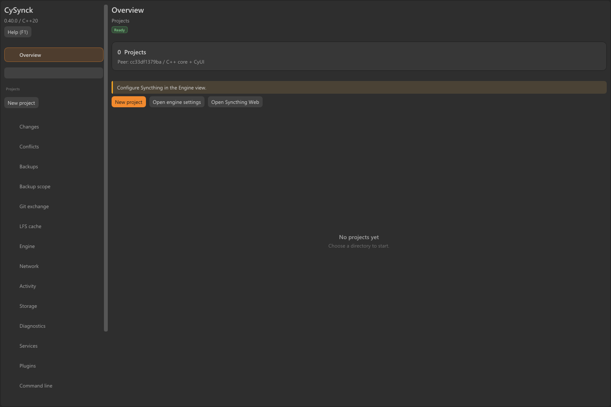

<table width="100%">
  <tr>
    <td width="300" align="left" valign="top">
      <a href="#offline-manual">Offline help</a><br>
      <a href="https://github.com/MrMybal/CySynck">Repository</a><br>
      <a href="https://github.com/MrMybal/CySynck/issues">Issues</a><br><br>
      <sub>README</sub><br>
      <a href="README.md">English</a> · <a href="README.fr.md">Français</a>
    </td>
    <td width="400" align="center" valign="middle">
      <strong>CySynck</strong><br>
      <sub>Desktop · CLI · SDK</sub>
    </td>
    <td width="300" align="right" valign="top">
      <p><sub>Application license</sub><br><a href="LICENSE"><strong>MIT</strong></a></p>
      <p><sub>Source versions</sub><br><a href="VERSION.md"><strong>Application 0.41.0</strong><br>Unreal bridge 0.2.0</a><br><strong>IN DEVELOPMENT</strong></p>
    </td>
  </tr>
</table>

<h1 align="center">CySynck</h1>

Synchronize projects, keep versioned backups and review file changes from one application. CySynck is a **C++20** companion to [Syncthing](https://github.com/syncthing/syncthing), with a native [CyUI](https://github.com/MrMybal/CyUI) desktop, a CLI, a Web console and a shared integration SDK. It is intended for people managing shared folders, Git projects and Linux servers.

> **IN DEVELOPMENT · 0.41.0**
>
> This is the current source version; no downloadable application release is published yet. Development builds require validation for your target workflow. Read the [version notes and documented limitations](VERSION.md).

[](assets/screenshots/desktop-0.40.0.png)

## About CySynck

Create a project for each folder and choose its synchronization mode, backup policy or Git exchange workflow. The desktop brings together differences, recovery copies, snapshots, Git/LFS operations and network tools. Its command panel uses the same commands as the standalone CLI. The original Syncthing Web interface remains accessible from the Engine view.

The desktop, CLI and Web/API console share one core. The core can also be embedded through its C++ interface or versioned C ABI, with trusted native plugins adding project modes. Linux servers can build without GUI dependencies. English is the default interface language; French is also included.

## Features

- **Project modes:** two-way, send-only and receive-only synchronization, backups, explicit Git exchange and native plugin modes.
- **Backups:** scheduling, exclusion previews, retention, whole-file/fixed-block/content-defined storage, integrity verification and selective restoration.
- **File review:** bounded side-by-side or unified differences, Git-compatible patches and explicit conflict resolution with preserved recovery copies.
- **Git and LFS:** verified bundle exchange, branch/commit/three-way review, reviewed merges, separate extraction, cache management, materialization, pointer restoration and export of preserved assets.
- **Direct networking:** WireGuard pairing, signed endpoint discovery, direct LAN/IPv6 candidates, project-scoped revocation, chat and verified resumable file transfers through an authenticated channel inside the VPN.
- **Desktop and operations:** tray integration, per-profile login startup, diagnostics and reviewed systemd/LaunchAgent service export.
- **Integration:** C++20 core, C ABI v1 using UTF-8 JSON, typed plugin options and buildable C/C++/plugin examples. The [Unreal bridge](integrations/unreal/README.md) provides queued asynchronous Blueprint requests and SDK staging.

## Offline manual

The complete **CyDoc** manual contains 45 topics in each language, including tutorials and public C++/C/plugin references. Search, bookmarks, notes and reading positions work locally. Reading requires no server, CDN, Node.js or Internet connection.

After building the sources or extracting a complete application package, open the matching reader route in a browser:

| Language | Reader path relative to the package or repository root |
| --- | --- |
| English (default) | `Documentation/Documentation.html#/en/overview` |
| Français | `Documentation/Documentation.html#/fr/overview` |

Keep the whole `Documentation/` directory, including `DocData/`, together. The generated reader is not tracked in Git and no hosted CySynck manual is currently published; the paths above become available after generation. Open it through `file://`, or use contextual help:

- **Desktop:** **Help (F1)** opens the current view's topic.
- **CLI:** `cysynck docs`, or `cysynck docs git-materialization --language fr --print` to obtain the local URL without launching a browser.
- **Web console:** contextual Help offers local opening on a loopback server or the complete `CySynck-Documentation.zip` for another workstation. Extract the archive before opening its `Documentation.html`.

To generate just the manual, run `npm ci --prefix .CyDocBuild` followed by `npm run build --prefix .CyDocBuild`. See the [documentation toolchain guide](.CyDocBuild/README.md) for authoring and translation maintenance.

---

## Installation

There are currently **no published binary downloads**. Build from the sources below. The [release page](https://github.com/MrMybal/CySynck/releases) is the destination for future application releases.

| Target | Availability | Start after installing into `dist/` |
| --- | --- | --- |
| Windows x64 | Source build; desktop, CLI and package validated locally | `dist/bin/cysynck-desktop.exe` |
| Linux desktop | Native CI build/package/runtime checks passed; hardware and service checks remain | `dist/bin/cysynck-desktop` |
| Linux server | Native CI and real Syncthing peer tests passed; host service/tunnel checks remain | `dist/bin/cysynck serve` |
| macOS | Native core/SDK/package CI passed, including software-rendered desktop captures | `open dist/CySynck.app` |

Install **Syncthing**, **Git**, **WireGuard** and **OpenSSL** separately for the workflows that need them; OpenSSL supplies P-256 signing for CyRevision and VPN endpoint publications, and Git LFS tracking tools are also external. CySynck does not bundle these programs. WireGuard requires suitable privileges and reachable UDP endpoints; peer discovery alone does not create connectivity through every NAT.

For a locally built Windows package, extract the full archive and run `Install-CySynck.ps1` from its root to install for the current user. Portable use is also available. Keep all package folders together, including libraries, Web assets and the manual. The manual's installation page explains updates and removal.

For a first local backup, use the CLI in `dist/bin/` with an existing folder:

```sh
cysynck project add Notes /absolute/path/to/notes --id notes --mode backup --interval 60 --keep 30
cysynck backup notes
cysynck verify notes
cysynck docs quickstart
```

Quote paths containing spaces and inspect the verification report's `ok` field. `--state DIR` selects a private profile. Scheduled work requires a running desktop or `cysynck serve`. Keep independent backups and restore into a new separate directory; multi-file operations are not filesystem transactions.

## Source, build and required libraries

Requirements: **CMake 3.24+**, a **C++20 compiler**, Git, **Node.js 22+** and npm. Node.js is used to build the manual; it is not needed to run the application or read the export. CMake fetches the pinned native dependencies. A pinned CyDoc package is included in the repository.

Windows builds use the Visual Studio 2022 C++ tools. macOS needs Xcode Command Line Tools. Linux desktop builds need OpenGL and GLFW's X11/Wayland development libraries; `libayatana-appindicator3-dev` enables the optional tray. The [native build workflow](.github/workflows/build.yml) lists the Linux packages used by CI.

<details>
<summary>Get the source, build, test and package</summary>

```sh
git clone https://github.com/MrMybal/CySynck.git
cd CySynck
npm ci --prefix .CyDocBuild
cmake -S . -B build -DCMAKE_BUILD_TYPE=Release
cmake --build build --config Release --parallel 3
ctest --test-dir build -C Release --output-on-failure
npm test --prefix .CyDocBuild
cmake --install build --config Release --prefix dist
cpack --config build/CPackConfig.cmake -C Release -B dist/packages
```

Add `-DCYSYNCK_DESKTOP=OFF` when configuring a headless server. Alternatively, `scripts/build.ps1` (`-ServerOnly` for headless) and `scripts/build.sh` (`CYSYNCK_DESKTOP=OFF` for headless) prepare dependencies, compile, test and install.

CMake generates and copies the complete manual and `CySynck-Documentation.zip` into the application package. Documentation authoring inputs are not shipped. To regenerate the manual separately:

```sh
npm run build --prefix .CyDocBuild
npm test --prefix .CyDocBuild
```

For real two-peer tests, configure `-DCYSYNCK_TEST_SYNCTHING=/path/to/syncthing` before building and running CTest. The offline manual's integration and plugin pages describe the installed SDK and examples.

The opt-in [multi-GiB workload test](.CyDocBuild/internal/LARGE-WORKLOAD.md) exercises interruption/resume and CDC restoration with real streamed data. Enable it with `-DCYSYNCK_LARGE_WORKLOAD_TESTS=ON` and allow 18 GiB free; it is excluded from default test runs. The Linux server CI also runs real WireGuard tunnels in isolated network namespaces.

</details>

---

## License

**CySynck uses the [MIT license](LICENSE).** Copyright © 2026 CyberAlien. Third-party components retain their own terms.

### Third-party libraries

| Library · source | License · terms | Use / scope |
| --- | --- | --- |
| [nlohmann/json 3.12.0](https://github.com/nlohmann/json) | [MIT](https://github.com/nlohmann/json/blob/v3.12.0/LICENSE.MIT) | Core JSON handling and public C++ SDK. |
| [cpp-httplib](https://github.com/yhirose/cpp-httplib) | [MIT](https://github.com/yhirose/cpp-httplib/blob/5814e121dfb5049f72a5c3956c3c8961b40da78b/LICENSE) | Core HTTP/API and direct networking. |
| [PicoSHA2](https://github.com/okdshin/PicoSHA2) | [MIT](https://github.com/okdshin/PicoSHA2/blob/161cb3fc4170fa7a3eca9e582cebd27cc4d1fe29/LICENSE) | Core SHA-256 checks. |
| [TinyXML2 10.0.0](https://github.com/leethomason/tinyxml2) | [zlib](https://github.com/leethomason/tinyxml2/blob/321ea883b7190d4e85cae5512a12e5eaa8f8731f/LICENSE.txt) | Core Syncthing XML configuration. |
| [CyUI](https://github.com/MrMybal/CyUI) | [MIT](https://github.com/MrMybal/CyUI/blob/a228501d9418550ce68d2d67b70cebbb8fa3ee2a/LICENSE) | Native desktop; Diff and Inspector modules, including Code. |
| [Dear ImGui](https://github.com/ocornut/imgui) | [MIT](https://github.com/ocornut/imgui/blob/1ab953d75a760d5102eb2d5c4c6c4e65df6b29f3/LICENSE.txt) | Native desktop widgets and backends. |
| [GLFW 3.4](https://github.com/glfw/glfw) | [zlib/libpng](https://github.com/glfw/glfw/blob/3.4/LICENSE.md) | Native desktop window and OpenGL context. |
| [Lexilla / Scintilla](https://github.com/MrMybal/CyUI/tree/a228501d9418550ce68d2d67b70cebbb8fa3ee2a/third_party) | [Lexilla/Scintilla permissive terms](https://github.com/MrMybal/CyUI/blob/a228501d9418550ce68d2d67b70cebbb8fa3ee2a/third_party/lexilla/License.txt) | Lexers and interfaces used by CyUI Code in the desktop. |
| [CyDoc 0.1.0](https://github.com/MrMybal/CyDoc) | [MIT](https://github.com/MrMybal/CyDoc/blob/main/LICENSE) | Bundled offline reader and build-time compiler; pinned archive and provenance in [.CyDocBuild/vendor](.CyDocBuild/vendor). |
| [marked 17.0.6](https://github.com/markedjs/marked) | [MIT; included Markdown license terms](https://github.com/markedjs/marked/blob/v17.0.6/LICENSE.md) | Build-time Markdown compilation through CyDoc. |
| [PrismJS 1.30.0](https://github.com/PrismJS/prism) | [MIT](https://github.com/PrismJS/prism/blob/v1.30.0/LICENSE) | Build-time highlighting; its notice accompanies the manual. |
| [esbuild 0.25.12](https://github.com/evanw/esbuild) | [MIT](https://github.com/evanw/esbuild/blob/v0.25.12/LICENSE.md) | Build-time reader bundling. |
| [Happy DOM 21.0.4](https://github.com/capricorn86/happy-dom) | [MIT](https://github.com/capricorn86/happy-dom/blob/v21.0.4/LICENSE) | Documentation tests only. |
| [GTK3](https://gitlab.gnome.org/GNOME/gtk) / [Ayatana AppIndicator](https://github.com/AyatanaIndicators/libayatana-appindicator) | [LGPL-2.1-or-later / LGPL-2.1 or LGPL-3.0 notices](THIRD_PARTY.md) | Optional system libraries for the Linux desktop tray; absent from headless builds. |
| Microsoft Visual C++ runtime | [Microsoft redistribution terms](THIRD_PARTY.md) | Runtime files redistributed with MSVC-built Windows packages. |

This table indexes the main components. Retain the complete [third-party notices](THIRD_PARTY.md) and license texts distributed under `share/cysynck/licenses/`, macOS Resources and `Documentation/DocData/licenses/`. It does not replace transitive dependency notices. No optional CyDoc media modules or Three.js are included. Syncthing, Git and WireGuard remain separate external installations with their own licenses.

## References and links

- [Offline manual and contextual help](#offline-manual) · [Version notes and limitations](VERSION.md).
- [Source repository](https://github.com/MrMybal/CySynck) · [Issue tracker](https://github.com/MrMybal/CySynck/issues) · [Releases](https://github.com/MrMybal/CySynck/releases).
- [Documentation generation and translations](.CyDocBuild/README.md) · [Public SDK headers](include/cysynck) · [Integration examples](examples).
- [Syncthing](https://github.com/syncthing/syncthing) · [CyUI](https://github.com/MrMybal/CyUI) · [CyDoc](https://github.com/MrMybal/CyDoc) · [WireGuard](https://www.wireguard.com/).
- [SyncTrayzor](https://github.com/GermanCoding/SyncTrayzor) is a functional reference. [CyRevision](https://github.com/MrMybal/CyRevision) 0.1.34's signed Git/LFS transport has a C++ adapter with explicit pinned identities and real bidirectional reference tests. Group admission remains managed by CyRevision. Their implementation sources are not incorporated in the application; see the [interop guide](.CyDocBuild/manual/en/cyrevision.md).
